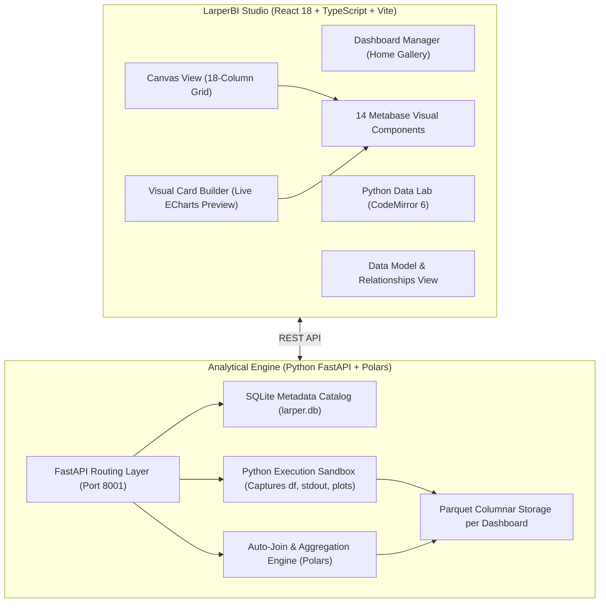

# LarperBI 📊

> **The Self-Service Open-Source BI Studio** — Power BI authoring experience meets Metabase visual aesthetics and in-browser Python EDA.

[](https://opensource.org/licenses/MIT)
[](https://www.python.org/)
[](https://fastapi.tiangolo.com/)
[](https://pola.rs/)
[](https://react.dev/)
[](https://www.typescriptlang.org/)
[](https://echarts.apache.org/)

---

## 🌟 Why LarperBI?

Existing BI tools force a tradeoff:
- **Traditional Cloud BI (Metabase, Superset)**: Admin-heavy setup. You must configure database connections and write SQL questions in isolation before assembling dashboards. Uploading a CSV requires external database write permissions.
- **Desktop BI (Power BI, Tableau)**: Great drag-and-drop authoring, but proprietary, platform-locked, heavy, and isolated from modern Python data workflows.

**LarperBI** bridges this gap:
1. **Start Blank & Drop Data**: Create a blank dashboard canvas and immediately drag-and-drop CSV or Excel files. No database setup required.
2. **Metabase Aesthetics**: Replicates Metabase's polished 18-column grid, 8-accent color ramp, typography, and clean card chrome.
3. **Built-in Python Data Lab**: Explore, clean, and aggregate data directly in the browser with CodeMirror 6 and Polars. Click **`[ ⚡ Save as Derived Table ]`** to materialize any DataFrame into the dashboard catalog instantly.
4. **Visual Modeling Without SQL**: Drag-and-drop card builder with live ECharts preview, star-schema relationships, and automatic backend join resolution.

---

## 🏗️ Architecture



---

## ⚡ Core Features

### 1. Zero-Friction Data Ingestion
- Drag-and-drop any `.csv` or `.xlsx` file onto the dashboard canvas.
- High-speed streaming ingestion via **Polars** into Zstandard-compressed Parquet tables.
- Automatic column type inference and semantic tagging:
  - **Measures (Metrics)**: Numeric values, cleaned currency fields (`$`), and quantities.
  - **Dimensions (Categories)**: Categorical strings, codes, and booleans.
  - **Date Dimensions**: Auto-parsed datetime columns with grain bucketing (`Year`, `Month`, `Day`).

### 2. 14 Replicated Metabase Visual Components
Fully re-engineered using **Apache ECharts 6.x** and **Mantine / CSS design tokens**:
- **`DashCard`**: 12px rounded container, card title, info tooltip, and hover actions.
- **`SmartScalar`**: Primary KPI big number with previous-period delta trend badge (`▲ +8.2% vs baseline`).
- **`ProgressBar`**: Horizontal target quota tracker with percentage fill and remaining delta.
- **`GaugeChart`**: Radial risk dial with needle pointer and Green / Yellow / Red threshold bands.
- **`WaterfallChart`**: Step-by-step bridge tracking additions (green), deductions (red), and net settlement (blue).
- **`FunnelChart`**: Multi-stage conversion funnel with step drop-offs and retention ratios.
- **`CartesianChart` (Multi-type)**: Smooth Area charts, dual-axis line trajectories, grouped bars, and horizontal row charts with conditional risk thresholds.
- **`DonutChart`**: Ring portfolio distribution with center totals and slice legends.
- **`ScatterPlot`**: 2D anomaly clustering with group categorization.
- **`BoxPlot`**: Five-number statistical distribution summary (`[min, Q1, median, Q3, max]`).
- **`TreemapChart`**: Hierarchical nested area tiles.
- **`SankeyChart`**: Multi-stage flow routing diagrams.
- **`PivotTable`**: Multi-dimensional matrix with sticky headers and cell heatmap background tinting.
- **`TableInteractive`**: Built on `@tanstack/react-table` with sortable headers, tabular numbers, and status badges.

### 3. Python Data Lab & One-Click Model Materializer
- In-browser **CodeMirror 6** editor with Python syntax highlighting and autocomplete.
- Dashboard tables are pre-injected into runtime memory as `df` and named Polars DataFrames.
- Real-time stdout capture, interactive DataFrame preview tables, and inline Matplotlib charts.
- **One-Click Export**: Click **`[ ⚡ Save as Derived Table ]`** to materialize any aggregated DataFrame into a new Parquet table in the dashboard catalog.

### 4. Visual Card Builder with Live Preview
- Click **`+ Add Visual Card`** or edit an existing card via the **Pencil icon**.
- Select source table (Raw Uploads or Derived Models) $\to$ choose visual type $\to$ pick Dimension and Measure.
- Sub-20ms interactive preview renders live in the modal before placing the card.

### 5. Data Model & Star Schema (Auto-Joins)
- Visual **Data Model** tab displaying all tables, schema definitions, row counts, and data types.
- Link foreign keys to primary keys (e.g. `transactions.card_id` $\to$ `cards.id`).
- When querying `transactions`, columns from `cards` become available automatically via backend join generation without writing SQL.

### 6. Interactive 18-Column Grid & Focus Mode
- Freeform card dragging and resizing with collision reflow powered by `react-grid-layout`.
- 40px corner bracket resize handles.
- **Focus / Zoom Mode**: Click the **Maximize** button (`Maximize2`) in the card header to expand any visual into an 80vh full-screen focus view.

---

## 🚀 Quick Start

### Prerequisites
- **Python 3.9+**
- **Node.js 18+** (Node 20+ or 24 recommended)
- **npm** or **pnpm**

---

### 1. Clone & Set Up the Backend

```bash
# Navigate to backend
cd LarperBI/backend

# Install Python dependencies
pip install fastapi uvicorn polars pydantic requests

# Start the API server on port 8001
python3 -m uvicorn app.main:app --host 127.0.0.1 --port 8001
```
*Interactive Swagger API documentation will be available at `http://127.0.0.1:8001/docs`.*

---

### 2. Set Up the Frontend

```bash
# In a new terminal, navigate to frontend
cd LarperBI/frontend

# Install dependencies
npm install

# Start Vite preview or development server (Port 5174)
npm run preview -- --port 5174 --host 127.0.0.1
# or: npm run dev
```

Open your browser at **`http://127.0.0.1:5174/`**.

---

### 3. (Optional) Seed the Demonstration Dashboard

To explore LarperBI with pre-loaded portfolio data:

```bash
cd LarperBI/backend
python3 seed_demo.py
```
This generates an active dashboard (**"FinTech Card Portfolio & Risk Model"**) with 6,146 rows, raw uploads, derived models, and pre-configured Metabase cards.

---

## 📁 Repository Structure

```
LarperBI/
├── backend/
│   ├── app/
│   │   ├── config.py              # Storage paths and directory defaults
│   │   ├── database.py            # SQLite schema (dashboards, tables, cards, relationships)
│   │   ├── main.py                # FastAPI REST endpoints
│   │   ├── query_engine.py        # Polars auto-join and aggregation query builder
│   │   ├── sandbox.py             # Python execution sandbox & derived table materializer
│   │   ├── schemas.py             # Pydantic v2 domain schemas
│   │   └── storage.py             # File ingestion & auto-profiling
│   ├── tests/
│   │   └── test_backend.py        # Complete backend integration test suite
│   └── seed_demo.py               # Demo seeder script
├── data/
│   ├── larper.db                  # Central SQLite metadata database
│   └── dashboards/
│       └── {dashboard_id}/        # Partitioned Parquet tables per dashboard
└── frontend/
    ├── src/
    │   ├── components/
    │   │   ├── CardBuilder/       # Visual Card Builder modal with live preview
    │   │   ├── DashboardCanvas/   # Canvas view, card renderer, and dropzone
    │   │   ├── DashboardManager/  # Home screen dashboard gallery & creator
    │   │   ├── ModelView/         # Star schema relationship builder
    │   │   ├── PythonLab/         # CodeMirror 6 Python EDA sandbox
    │   │   ├── grid/              # 18-column grid layout wrapper & resize handles
    │   │   └── metabase-viz/      # 14 Replicated Metabase visual components
    │   ├── services/
    │   │   └── api.ts             # Typed REST API client
    │   ├── styles/
    │   │   └── metabase-theme.css # Metabase 8-accent palette & design tokens
    │   ├── types/
    │   │   └── larper.ts          # Studio TypeScript interfaces
    │   └── App.tsx                # Studio router & workspace navigation
    ├── package.json
    └── vite.config.ts
```

---

## 🛠️ API Reference Summary

| Method | Endpoint | Description |
| :--- | :--- | :--- |
| `GET` | `/api/v1/dashboards` | List all saved dashboards with card & table counts |
| `POST` | `/api/v1/dashboards` | Create a new blank dashboard |
| `GET` | `/api/v1/dashboards/{id}` | Get dashboard detail with tables, cards, and relationships |
| `PUT` | `/api/v1/dashboards/{id}` | Rename or update dashboard metadata |
| `DELETE` | `/api/v1/dashboards/{id}` | Delete dashboard and cascade-delete its Parquet storage |
| `POST` | `/api/v1/dashboards/{id}/upload` | Upload CSV/Excel and auto-profile into Parquet |
| `POST` | `/api/v1/dashboards/{id}/sandbox/execute` | Execute Python EDA snippet in isolated sandbox |
| `POST` | `/api/v1/dashboards/{id}/derived-tables` | Materialize DataFrame as a derived dashboard table |
| `POST` | `/api/v1/dashboards/{id}/relationships` | Link foreign key relationship between tables |
| `POST` | `/api/v1/dashboards/{id}/query` | Execute aggregation query for visual cards (with auto-joins) |
| `POST` | `/api/v1/dashboards/{id}/cards` | Add visual card to dashboard canvas |
| `PUT` | `/api/v1/dashboards/{id}/cards/{card_id}` | Reconfigure card fields, visual type, or title |
| `PUT` | `/api/v1/dashboards/{id}/layout` | Save updated 18-column grid card positions `[x, y, w, h]` |

---

## 🤝 Contributing & License

Contributions are welcome! Please open an issue or submit a pull request.

Distributed under the **MIT License**. See `LICENSE` for details.
