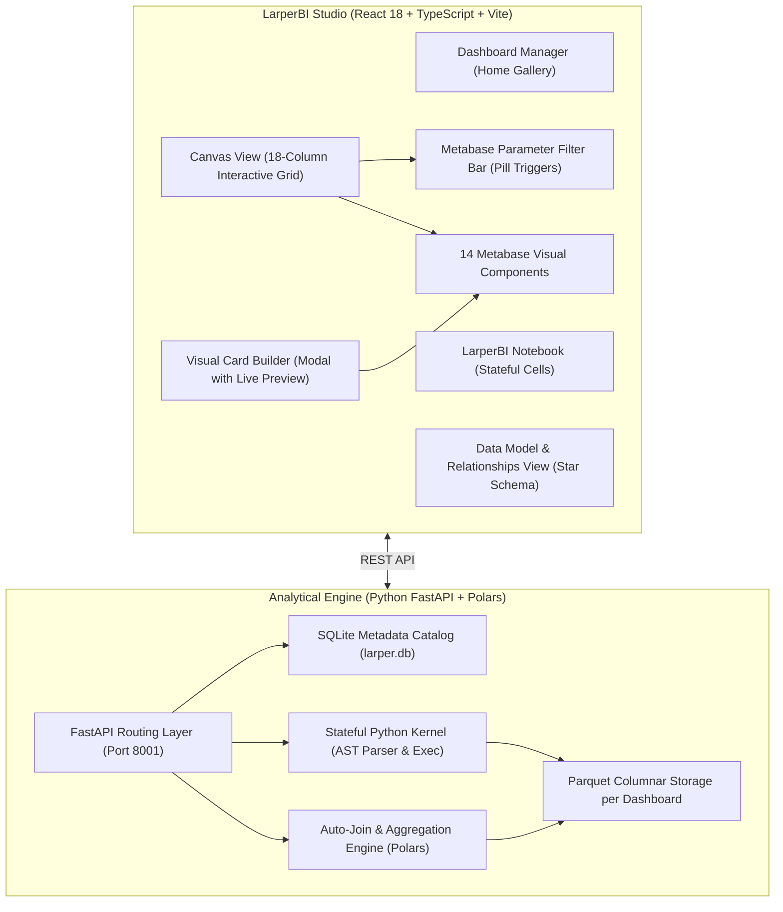

# LarperBI 📊

> **The Self-Service Open-Source BI Studio** — Power BI authoring experience meets Metabase visual aesthetics, Metabase parameter filtering, and a stateful in-product Python notebook for EDA.

[](https://opensource.org/licenses/MIT)
[](https://www.python.org/)
[](https://fastapi.tiangolo.com/)
[](https://pola.rs/)
[](https://react.dev/)
[](https://www.typescriptlang.org/)
[](https://echarts.apache.org/)

---

## 🌟 Why LarperBI?

Existing BI tools force a tradeoff:
- **Traditional Cloud BI (Metabase, Superset)**: Admin-heavy setup. You must configure database connections and write SQL questions in isolation before assembling dashboards. Uploading a CSV requires external database write permissions.
- **Desktop BI (Power BI, Tableau)**: Great drag-and-drop authoring, but proprietary, platform-locked, heavy, and isolated from modern Python data workflows.

**LarperBI** bridges this gap:
1. **Start Blank & Drop Data**: Create a blank dashboard canvas and immediately drag-and-drop CSV or Excel files. No database setup required.
2. **Metabase Aesthetics**: Replicates Metabase's polished 18-column grid, 8-accent color ramp, typography, and clean card chrome.
3. **Metabase Parameter Filter Bar**: Dedicated top filter bar with interactive pill triggers, category multi-select popovers, date ranges, and live cross-filtering across all cards.
4. **Notebook (EDA)**: Cell-based Python notebook styled with LarperBI’s Metabase design tokens — per-cell execution (`In [ ]` / `Out [ ]`), stateful kernel memory, CodeMirror editor with `# Enter Python code` placeholder, execution timers, and one-click model materialization (`[ ⚡ Save as Derived Table ]`).
5. **Visual Modeling Without SQL**: Drag-and-drop card builder with live ECharts preview, star-schema relationships, and automatic backend join resolution.
6. **Re-configurable Visual Cards**: Edit any placed card at any time via its header pencil icon, updating charts in place without re-creating.

---

## 🏗️ Architecture



---

## ⚡ Core Features

### 1. Zero-Friction Data Ingestion
- Drag-and-drop any `.csv` or `.xlsx` file onto the dashboard canvas.
- High-speed streaming ingestion via **Polars** into Zstandard-compressed Parquet tables.
- Automatic column type inference and semantic tagging:
  - **Measures (Metrics)**: Numeric values, cleaned currency fields (`$`), and quantities.
  - **Dimensions (Categories)**: Categorical strings, codes, and booleans.
  - **Date Dimensions**: Auto-parsed datetime columns with grain bucketing (`Year`, `Month`, `Day`).

### 2. 14 Replicated Metabase Visual Components
Fully re-engineered using **Apache ECharts 6.x** and **Mantine / CSS design tokens**:
- **`DashCard`**: 12px rounded container, card title, info tooltip, and hover action buttons.
- **`SmartScalar`**: Primary KPI big number with previous-period delta trend badge (`▲ +8.2% vs baseline`).
- **`ProgressBar`**: Horizontal target quota tracker with percentage fill and remaining delta.
- **`GaugeChart`**: Radial risk dial with needle pointer and Green / Yellow / Red threshold bands.
- **`WaterfallChart`**: Step-by-step bridge tracking additions (green), deductions (red), and net settlement (blue).
- **`FunnelChart`**: Multi-stage conversion funnel with step drop-offs and retention ratios.
- **`CartesianChart` (Multi-type)**: Smooth Area charts, dual-axis line trajectories, grouped bars, and horizontal row charts with conditional risk thresholds.
- **`DonutChart`**: Ring portfolio distribution with center totals and slice legends.
- **`ScatterPlot`**: 2D anomaly clustering with group categorization.
- **`BoxPlot`**: Five-number statistical distribution summary (`[min, Q1, median, Q3, max]`).
- **`TreemapChart`**: Hierarchical nested area tiles.
- **`SankeyChart`**: Multi-stage flow routing diagrams.
- **`PivotTable`**: Multi-dimensional matrix with sticky headers and cell heatmap background tinting.
- **`TableInteractive`**: Built on `@tanstack/react-table` with sortable headers, tabular numbers, and status badges.

### 3. LarperBI Notebook (EDA Environment)
- **Cell Structure**: Discrete Code and Markdown cells in LarperBI-themed cards (Inter typography, brand-blue active border, soft shadows) with `In [ 1 ]` / `Out [ 1 ]` indicators.
- **Left Gutter Play Button (`▶`)**: Direct execution with execution timers (`✓ 0.1ms`).
- **Hover Cell Divider**: Hover between cells to insert `[ + Code ]` or `[ + Markdown ]` anywhere.
- **Native Placeholder**: Newly added code cells mount with an empty buffer and a clean `# Enter Python code` placeholder that disappears automatically on typing.
- **Genuine IPython AST Execution**: Uses Python's `ast` parser. Cells with `print("Boom")` output only text. Interactive tables render **only** when a DataFrame is explicitly evaluated on the final line.
- **`[ ⚡ Save as Derived Table ]`**: One-click action on any DataFrame output to materialize it into a new Parquet table in the dashboard catalog.

### 4. Metabase Parameter / Filter Bar
- Dedicated filter bar mounted at the top of the canvas (`ParameterBar.tsx`):
  - Pill buttons with filter icon, name, and active selection badge.
  - Active blue highlighting with inline `X` clear action.
  - Floating popovers with searchable multi-select checkboxes, date presets, and custom calendar ranges.
  - Cross-filtering: selecting any filter dynamically updates all cards across the dashboard in real time.

### 5. Visual Card Builder with Live Preview & Re-Configurability
- Click **`+ Add Visual Card`** to author a new card, or click the **Pencil icon** on any canvas card to edit it.
- Pre-populated fields in Edit Mode: modify chart type, swap dimensions, adjust aggregations, or rename titles.
- Sub-20ms interactive preview renders live in the modal before committing changes.

### 6. Data Modeling: New Tables, Columns, Star Schema & Saved Metrics
- **New Derived Table (Aggregation)**: Click **`+ New Derived Table`** to build a group-by + measure aggregation into a new first-class Parquet table — no SQL required.
- **New Empty Table (Manual)**: Click **`+ New Empty Table`** to declare a schema (name + type per column) and create a zero-row table. Fill or transform it later with a Python script.
- **New Python Table (Scripted)**: Click **`+ New Python Table`** to define a table by code. Tables are pre-loaded as Polars DataFrames (`df` = first table); assign the output to `result` (Polars or pandas, including numpy values wrapped in a DataFrame). Scripts are stored, and **Refresh** re-executes them.
- **Script & Refresh existing tables**: Every table card has a **Script** button. Editing a script runs it against the table's current snapshot, so you can extend or transform existing data. Failed runs never overwrite the last good snapshot.
- **Helper (Independent) Tables**: Set the role to `helper` for standalone lookup/sort/manual tables. They show a **Helper · Independent** badge and are excluded from derived-table base pickers, so they never entangle the data model.
- **New Column (Calculated Column)**: Click **`+ Column`** on any table card to append a row-level computed column (e.g. `credit_limit / num_cards_issued`, `amount * quantity`) using a safe expression parser (`+ - * / % **`, `abs(x)`, `round(x, n)`).
- **Tables & Relationships**: Visual **Data Model** tab listing every table, schema definitions, row counts, and data types. Link foreign keys to primary keys (e.g. `transactions.card_id` $\to$ `cards.id`); columns from linked tables become queryable automatically via backend join generation without writing SQL.
- **Drag-to-Link Keys (Power BI style)**: Drag any column onto another table's column to create the relationship — a live dashed connector follows the pointer and the target column highlights on hover. Key columns are marked with a gold key icon. Self-links, unknown columns, and duplicate relationships are rejected with clear errors.
- **Saved Metrics (Measures)**: Dedicated **★ Saved Metrics** sub-tab for reusable calculation recipes — not table columns:
  - **Simple Aggregation**: `sum(credit_limit)`, `avg(amount)`, `count_distinct(card_id)`, `min`, `max`.
  - **Ratio / Rate**: `sum(is_fraud) / count() × 100` with configurable multiplier (100 for percentages).
  - **Display Format**: Currency, Percentage, or Number, applied automatically to every card using the metric.
  - Metrics appear as **★ Saved Metrics** in the Card Builder Y-Axis picker and are evaluated dynamically against whatever dimensions and dashboard filters are active. Editing a card pre-selects its saved metric.


### 7. Interactive 18-Column Grid & Focus Mode
- Freeform card dragging and resizing with collision reflow powered by `react-grid-layout`.
- 40px corner bracket resize handles.
- **Full Dynamic Chart Scaling**: Charts expand in real time to fill resized cards.
- **Focus / Zoom Mode**: Click the **Maximize** button (`Maximize2`) in the card header to expand any visual into an 80vh full-screen focus view.

### 8. Data View (Excel-Style Row Browser, LarperBI Theme)
- Excel / Power BI Data view / VS Code Data Wrangler–style grid for any dashboard table, styled with LarperBI’s Metabase tokens: one cohesive card containing toolbar → grid → attached status/pager → sheet tabs, filling the viewport.
- **Sheet tabs**: tables appear as tabs attached to the card bottom (helper tables marked with a dot); click to switch.
- **Header autofilters**: every column has a dropdown menu with **Sort Ascending / Descending**, a **value search box**, and a **class checklist** (Select All / Clear / Apply). Filtered columns show a brand-blue funnel icon; a toolbar button clears all filters at once.
- **Server-side filtering**: value selections are applied in Polars (`cast(String).is_in([...])`), with filtered vs. unfiltered counts.
- **Server-side paging**: 25 / 50 / 100 / 250 rows per page (max 500) — never loads the whole table.
- **Global search** across all columns (debounced, case-insensitive), sticky headers, and first / prev / next / last paging.
- Numeric columns right-aligned with tabular figures; nulls render as muted `null`.

---

## 🚀 Quick Start

### Prerequisites
- **Python 3.9+**
- **Node.js 18+** (Node 20+ or 24 recommended)
- **npm** or **pnpm**

---

### 1. Set Up the Backend

```bash
# Navigate to backend
cd LarperBI/backend

# Install Python dependencies
pip install fastapi uvicorn polars pydantic requests

# Start the API server on port 8001
python3 -m uvicorn app.main:app --host 127.0.0.1 --port 8001 --reload
```
*Interactive Swagger API documentation is available at `http://127.0.0.1:8001/docs`.*

---

### 2. Set Up the Frontend

```bash
# In a new terminal, navigate to frontend
cd LarperBI/frontend

# Install dependencies
npm install

# Start Vite preview or development server (Port 5174)
npm run preview -- --port 5174 --host 127.0.0.1
# or: npm run dev
```

Open your browser at **`http://127.0.0.1:5174/`**.

---

### 3. (Optional) Seed the Demonstration Dashboard

To explore LarperBI with pre-loaded portfolio data:

```bash
cd LarperBI/backend
python3 seed_demo.py
```
This generates an active dashboard (**"FinTech Card Portfolio & Risk Model"**) with 6,146 rows, raw uploads, derived models, and pre-configured Metabase cards.

---

## 📁 Repository Structure

```
LarperBI/
├── backend/
│   ├── app/
│   │   ├── config.py              # Storage paths and directory defaults
│   │   ├── database.py            # SQLite schema (dashboards, tables, cards, filters, relationships)
│   │   ├── main.py                # FastAPI REST endpoints
│   │   ├── notebook_session.py    # Stateful Python kernel session manager (AST execution)
│   │   ├── query_engine.py        # Polars auto-join and aggregation query builder
│   │   ├── sandbox.py             # Sandbox execution & derived table materializer
│   │   ├── schemas.py             # Pydantic v2 domain schemas
│   │   └── storage.py             # File ingestion & auto-profiling
│   ├── tests/
│   │   └── test_backend.py        # Complete backend integration test suite
│   └── seed_demo.py               # Demo seeder script
├── data/
│   ├── larper.db                  # Central SQLite metadata database
│   └── dashboards/
│       └── {dashboard_id}/        # Partitioned Parquet tables & notebook.json per dashboard
└── frontend/
    ├── src/
    │   ├── components/
    │   │   ├── CardBuilder/       # Visual Card Builder modal with live preview
    │   │   ├── DashboardCanvas/   # Canvas view, card renderer, and dropzone
    │   │   ├── DashboardManager/  # Home screen dashboard gallery & creator
    │   │   ├── ModelView/         # Star schema relationship builder
    │   │   ├── Notebook/          # LarperBI-themed cell-based Python notebook
    │   │   ├── parameters/        # Metabase parameter filter bar & popover widgets
    │   │   ├── grid/              # 18-column grid layout wrapper & resize handles
    │   │   └── metabase-viz/      # 14 Replicated Metabase visual components
    │   ├── services/
    │   │   └── api.ts             # Typed REST API client
    │   ├── styles/
    │   │   └── metabase-theme.css # Metabase 8-accent palette & design tokens
    │   ├── types/
    │   │   └── larper.ts          # Studio TypeScript interfaces
    │   └── App.tsx                # Studio router & workspace navigation
    ├── package.json
    └── vite.config.ts
```

---

## 🛠️ API Reference Summary

| Method | Endpoint | Description |
| :--- | :--- | :--- |
| `GET` | `/api/v1/dashboards` | List all saved dashboards with card & table counts |
| `POST` | `/api/v1/dashboards` | Create a new blank dashboard |
| `GET` | `/api/v1/dashboards/{id}` | Get dashboard detail with tables, cards, filters, and relationships |
| `PUT` | `/api/v1/dashboards/{id}` | Rename or update dashboard metadata |
| `DELETE` | `/api/v1/dashboards/{id}` | Delete dashboard and cascade-delete its Parquet storage |
| `POST` | `/api/v1/dashboards/{id}/upload` | Upload CSV/Excel and auto-profile into Parquet |
| `GET` | `/api/v1/dashboards/{id}/filters` | List dashboard filter parameters |
| `POST` | `/api/v1/dashboards/{id}/filters` | Add a new filter parameter |
| `DELETE` | `/api/v1/dashboards/{id}/filters/{filter_id}` | Remove a filter parameter |
| `GET` | `/api/v1/dashboards/{id}/tables/{table_id}/columns/{col}/distinct` | Fetch distinct values for category filter popover |
| `GET` | `/api/v1/dashboards/{id}/tables/{table_id}/rows` | Paginated row browser (search, sort, page size, per-column value filters) |
| `GET` | `/api/v1/dashboards/{id}/metrics` | List saved metrics (measures) for the dashboard |
| `POST` | `/api/v1/dashboards/{id}/metrics` | Define a new simple-aggregation or ratio metric |
| `DELETE` | `/api/v1/dashboards/{id}/metrics/{metric_id}` | Delete a saved metric |
| `GET` | `/api/v1/dashboards/{id}/notebook` | Load dashboard Jupyter Notebook state |
| `PUT` | `/api/v1/dashboards/{id}/notebook` | Persist dashboard Jupyter Notebook state |
| `POST` | `/api/v1/dashboards/{id}/notebook/execute-cell` | Execute a cell in the persistent kernel session |
| `POST` | `/api/v1/dashboards/{id}/notebook/restart` | Restart the Python kernel session |
| `POST` | `/api/v1/dashboards/{id}/derived-tables` | Materialize DataFrame as a derived dashboard table |
| `POST` | `/api/v1/dashboards/{id}/derived-tables/aggregate` | Build an aggregated derived table (group-by + measure) |
| `POST` | `/api/v1/dashboards/{id}/tables/{table_id}/calculated-column` | Append a row-level calculated column to a table |
| `POST` | `/api/v1/dashboards/{id}/tables/empty` | Create a zero-row manual table from a declared schema |
| `POST` | `/api/v1/dashboards/{id}/tables/python` | Create a Python-scripted table from a `result` DataFrame |
| `PUT` | `/api/v1/dashboards/{id}/tables/{table_id}/script` | Save and run a table script (replaces the snapshot on success) |
| `POST` | `/api/v1/dashboards/{id}/tables/{table_id}/refresh` | Re-run a table's stored script and refresh its snapshot |
| `POST` | `/api/v1/dashboards/{id}/relationships` | Link foreign key relationship between tables |
| `POST` | `/api/v1/dashboards/{id}/query` | Execute aggregation query for visual cards (with auto-joins & filters) |
| `POST` | `/api/v1/dashboards/{id}/cards` | Add visual card to dashboard canvas |
| `PUT` | `/api/v1/dashboards/{id}/cards/{card_id}` | Reconfigure card fields, visual type, or title |
| `PUT` | `/api/v1/dashboards/{id}/layout` | Save updated 18-column grid card positions `[x, y, w, h]` |

---

## 🤝 Contributing & License

Contributions are welcome! Please open an issue or submit a pull request.

Distributed under the **MIT License**. See `LICENSE` for details.
